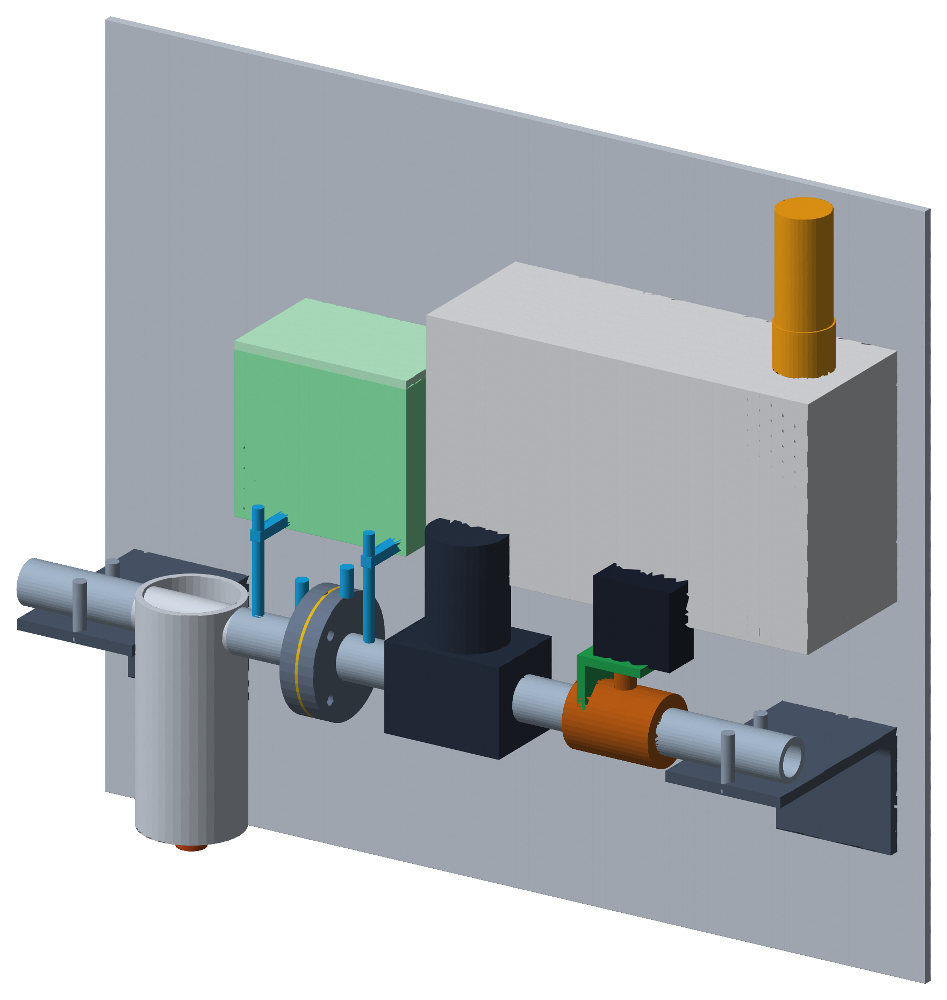
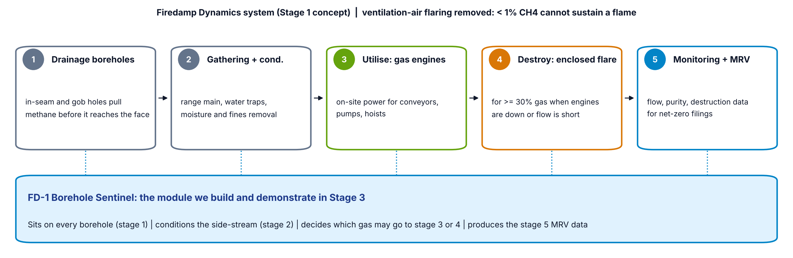

# Firedamp Dynamics · FD-1 Borehole Sentinel

**Vishwakarma Awards 2026-27** · Sustainable Mining (IIT Hyderabad) · Application ID **VK26-IITH-SM-0008** · Team Chakra



India drains methane out of its gassiest coal seams for safety, then mostly lets it go. Ember (2026) found no commercial coal mine methane project running in the country, while emissions are on track to pass 1.6 Mt a year by the end of the decade. Gas can only be used or flared safely when its quality is known, and a single leaking borehole collar can dilute a whole drainage range toward the 5-15% explosive band without anyone seeing which hole is at fault.

Firedamp Dynamics is a five-stage capture system: drainage, conditioning, utilisation, destruction and MRV. **FD-1 is the module we build first.** It sits on each borehole and does four things:

- measures methane (NDIR), oxygen, flow (ISO 5167 orifice) and line pressure at that hole, once a second
- throttles the hole when air leaks in, and isolates it below 25% CH4 or above 10% O2
- checks itself: methane from the NDIR must agree with methane implied by oxygen (1 − O2/20.95)
- logs per-borehole methane totals for MRV, corrected for gas density



## Key numbers

| | |
|---|---|
| Routing bands | route ≥ 30% CH4 (2 × upper explosive limit, UNECE 2016) · throttle 25-30% · isolate < 25% |
| Leak model | moderate leak held at ≥ 28.5% CH4 by throttling; gross leak isolated at 331 s; unmanaged range falls to 17.0% |
| Flow accuracy | density correction removes a 14.4% under-read at 60% CH4 |
| Bracket FEA | rev A FoS 1.87 → rev B FoS 3.87 (12 kg spool at 4 g, Al 6061-T6) |
| Electronics | KiCad 7 schematic, 44 parts, 44 nets, netlist check 0 errors |
| Cost | ₹21,660 parts per bench node · ₹68,670 full rig (pre-order estimates) |
| Value | one borehole draining 0.3 m3/min CH4 ≈ $190/day of gas at Ember's import-offset rate |

Every number has a source or a script: see [docs/sources.md](docs/sources.md).

## Repository

| Path | Contents |
|---|---|
| `cad/src/fd1_assembly.py` | Parametric CadQuery model, 24 parts, driven by one parameter block |
| `cad/step/`, `cad/stl/` | STEP for every part plus the assembly; STL for printing (chamber, servo bracket) |
| `electronics/kicad/` | Native KiCad 7 schematic, exported netlist, PDF/SVG, generator and connectivity checker |
| `electronics/bom.csv` | 27-line BOM with source and lead time |
| `firmware/fd1_node/` | ESP32-S3 firmware: state machine, flow maths, MRV totals, pin map, thresholds |
| `analysis/` | Bracket FEA (scikit-fem), gas and orifice calculations, closed-loop leak model, unit economics |
| `docs/` | Diagram scripts, all deck figures, sources, patent notes |
| `test-rig/test_plan.md` | Eight bench tests with pass criteria |

## Reproduce

```bash
pip install cadquery trimesh scikit-fem matplotlib numpy scipy pygments
python cad/src/fd1_assembly.py && python cad/src/render.py
python analysis/bracket_fea.py && python analysis/gas_calcs.py && python analysis/leak_sim.py
python electronics/bom.py && python electronics/schematic.py
python docs/diagrams.py && python docs/research_figures.py
# KiCad 7+
cd electronics/kicad && python gen_schematic.py \
  && kicad-cli sch export netlist fd1_controller.kicad_sch -o fd1_controller.net \
  && python check_netlist.py
```

## Safety

The bench rig runs on CO2 as a non-flammable stand-in for seam gas, with purity read from the O2 cell. The only methane on the bench is a small certified span cylinder at 2.5% (below the lower explosive limit). The prototype is not Ex certified and will not go underground; field equipment needs DGMS approval under the Coal Mines Regulations 2017 and an IEC 60079 Group I design.

## Status

Stage 2 design complete. Next: footprints and PCB layout in KiCad, sensor drivers replacing the firmware stubs, rig calibration (see the roadmap in the deck).
